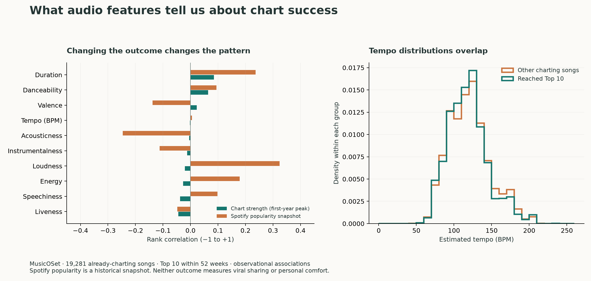
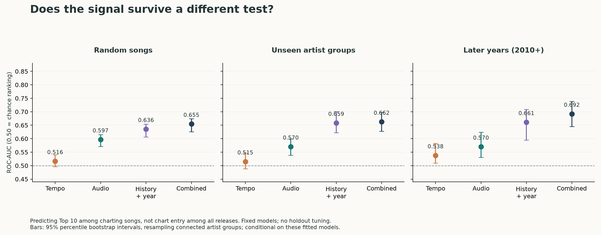
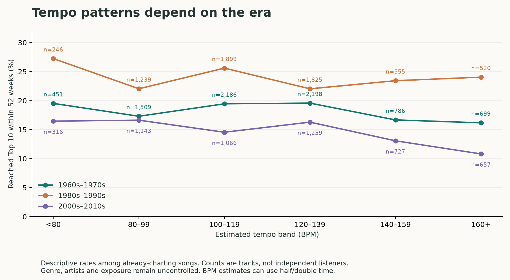

# What makes a song popular or viral?

Research and analysis completed 5 November 2026. This is a focused evidence review plus a reproducible exploratory analysis, not a systematic review or a validated hit-prediction product.

**The evidence supports useful musical signals, but not a universal frequency band or BPM that makes a hit.** Musical structure affects pleasure, movement and memory. Commercial success also depends on which people encounter the song, artist history, cultural context and social influence. These outcomes need separate measurements.

Our new analysis uses **19,281 eligible songs** from the authors' [MusicOSet research release](https://marianaossilva.github.io/DSW2019/). Tempo alone was weak at ranking Top-10 outcomes in later-year cohorts within this already-charting population. Audio descriptors added some information, while historical artist context was more useful in our fixed-model comparison. This is evidence about one historical sample and task, not a universal limit on music prediction.

## 1. Define the outcome before looking for a recipe

| Outcome | Appropriate measurement | What it does not establish |
| --- | --- | --- |
| Pleasure / liking | Blinded ratings or choosing to hear more | A hit, broad appeal, or comfort during a migraine |
| Groove | Urge to move, tapping or movement | Memorability or sharing |
| Catchiness | Perceived catchiness plus delayed recognition/recall | Commercial success |
| Popularity | Streams, unique listeners, chart entry or peak within a named period/market | How the song spread |
| Breakout growth | Future listener/creator growth, with a minimum starting audience and absolute-growth requirement | Person-to-person diffusion |
| Structural virality | Actual multi-generation adoption/referral cascades | Merely a large play count |
| Comfort | Individual comfort, clarity and stopping/discomfort outcomes | Any of the popularity measures above |

A song can receive millions of plays from one prominent placement. Another can spread through many generations of peer sharing. Those are different processes. [Goel et al. (2016)](https://5harad.com/papers/twiral.pdf) formalized this distinction using large-scale Twitter diffusion data; their study is useful for measurement, not direct proof about music or TikTok.

## 2. What musical features have research support?

**Rhythm has structure beyond its speed.** [Witek et al. (2014)](https://pmc.ncbi.nlm.nih.gov/articles/PMC3989225/) had 66 listeners rate 50 drum patterns. Medium syncopation, where some accents depart from the expected beat, produced the strongest average pleasure and urge to move. Every stimulus was already at 120 BPM. The result supports measuring the relationship between events and the beat; it cannot identify 120 BPM as the ideal tempo or predict viral sharing. The useful amount of syncopation depends on the listener and musical context.

**Groove and catchiness are distinguishable.** [Bechtold, Curry and Witek (2025)](https://www.frontiersin.org/journals/psychology/articles/10.3389/fpsyg.2025.1642561/full) studied 92 listeners and 54 generated instrumental tracks using short excerpts. The estimated increase in urge to move at 120 versus 90 BPM was small, approximately 0.279 on a seven-point scale; the catchiness difference was approximately zero. This does not prove tempo never affects catchiness. It demonstrates why a danceability score cannot automatically serve as a memorability or virality label. [Their study materials are open](https://osf.io/42yd6/); we did not analyze those raw ratings here.

**Pleasure depends on expectation and surprise together.** [Cheung et al. (2019)](https://www.marcus-pearce.com/assets/papers/CheungEtAl2019.pdf) modeled approximately 80,000 chords from 745 songs and conducted separate behavioral and imaging studies with 39 and 40 analyzed participants. Unexpected chords could be pleasurable in predictable contexts, while expected chords could be pleasurable in uncertain contexts. The result is more specific than “moderate surprise is always best.” It concerns Western tonal chord sequences and pleasure, not the future market success of the original recordings.

**Repetition is a useful hypothesis with qualified evidence.** [Nunes, Ordanini and Valsesia (2015)](https://www.francescavalsesia.com/uploads/1/0/5/1/105151509/the_power_of_repetition_jcp_2015.pdf) combined two experiments with an analysis of 2,480 songs at the extremes of the Billboard chart. Repetition was associated with market success and processing fluency, but the experiments were not uniformly strong: one effect was small and the second reported p<.08. This supports testing memorable recurring phrases. It does not establish an optimal chorus count or prove that adding repetitions causes a hit.

**Some frequency manipulations can change behavior in a particular setting.** [Cameron et al. (2022)](https://trainorlab.mcmaster.ca/publications/pdfs/2022_Cameron.pdf) alternated specialized 8–37 Hz speakers on and off at an electronic concert. The 43 analyzed participants moved about 11.8% more when the speakers were on. This was a movement outcome in one live-concert setting. It is not evidence that adding an 8–37 Hz tone to headphones creates a viral, pleasant or migraine-comforting track. Equipment, physical vibration, context and the measured outcome matter.

**Bass timing has competing mechanistic evidence.** [Hove et al. (2014)](https://trainorlab.mcmaster.ca/publications/pdfs/PNAS_2014_Low_pitch_timing.pdf) found stronger responses to early low-pitched events in a particular EEG/tapping paradigm. [Wojtczak et al. (2017)](https://pubmed.ncbi.nlm.nih.gov/28096408/) tested early and late events and found no general low-frequency timing superiority. A sensible feature is the alignment of bass and other onsets; a claim that one bass band universally drives rhythm or popularity would overreach.

**Distinctiveness is relative to a scene and era.** [Askin and Mauskapf (2017)](https://business.columbia.edu/sites/default/files-efs/pubfiles/25509/Mauskapf_productfeatures.pdf) analyzed nearly 27,000 chart songs and found that position relative to musical peers helped explain chart performance, beyond artist and industry factors. The implication is to measure similarity against relevant contemporary music, not a timeless “hit fingerprint.” Their observational, already-charting sample does not establish the hit probability of an arbitrary new release.

## 3. Why the same audio can have different success

**Social information can change which songs win.** [Salganik, Dodds and Watts (2006)](https://www.princeton.edu/~mjs3/salganik_dodds_watts06_full.pdf) randomized 14,341 participants into artificial music markets. Showing other people's download choices increased both concentration of success and unpredictability across separate markets. Independent appeal still mattered. Identical songs did not have one inevitable popularity ranking. A [follow-up experiment](https://www.princeton.edu/~mjs3/salganik_watts08.pdf) manipulated displayed rankings and found partially self-fulfilling effects, further demonstrating the role of social context.

**Distribution changes demand without changing frequencies.** [Aguiar and Waldfogel (2021)](https://onlinelibrary.wiley.com/doi/10.1111/joie.12263) used quasi-experimental methods to estimate substantial effects from Spotify playlist placement. This is stronger evidence than a simple correlation between playlist inclusion and streams, although the estimates remain specific to historical playlists, selected tracks and identifying assumptions. It supports including exposure and placement in a study of commercial outcomes.

**TikTok effects are heterogeneous and measurement-sensitive.** The [final 2026 paper by Winkler and colleagues](https://link.springer.com/article/10.1007/s11129-026-09312-2) finds aggregate streaming losses after UMG's TikTok withdrawal, concentrated among heavily TikTok-used tracks; its result differs from the early preprint headline. [Cheng, Ofek and Yoganarasimhan (2026)](https://pubsonline.informs.org/doi/10.1287/mksc.2024.1170) report no significant overall effect with heterogeneous substitution and discovery effects. Different samples, weighting and identification choices matter when a few tracks dominate consumption. Neither study identifies a sound-frequency recipe or a universal promotional lift.

**Prediction papers contain real signals and easy-to-misread numbers.** [Interiano et al. (2018)](https://pmc.ncbi.nlm.nih.gov/articles/PMC5990848/) studied over 500,000 UK releases. An illustrative forward-year comparison achieved 74% accuracy from audio descriptors and 85% after adding prior artist chart success. Both training and test sets were artificially balanced: the 2014 evaluation used 526 charted and 526 sampled non-charted tracks, despite 13,592 non-charted tracks in the underlying pool. The headline therefore does not mean 85% of predicted real-world releases become hits. [Zangerle et al. (2019)](https://archives.ismir.net/ismir2019/paper/000037.pdf) likewise explicitly acknowledge balanced-class limitations in their audio prediction study.

## 4. Our actual data analysis

**Source and target.** MusicOSet contains 20,405 feature records and 250,392 weekly chart rows. The actual chart file spans 1964–2018. We predict whether a song reaches the Top 10 during the first 52 weeks from its first observed chart appearance, including the debut week. All analyzed songs already charted. The Spotify popularity field is a historical snapshot, not release-time popularity, current popularity or viral growth. The files contain proprietary Spotify descriptors, not raw bass-band spectra, hooks or sharing paths. See the [authors' paper](https://marianaossilva.github.io/DSW2019/assets/data/paper.pdf) and [source manifest](../data/music-popularity-sources.json).

**Quality control.** The audit found incorrect recording matches, including tribute and emulation versions, as well as conflicting chart identities. We excluded one song with conflicting song/week rows, 457 songs without an observed start or sufficient potential follow-up, four ambiguous identity records, 658 records with explicit wrong-version markers, and one invalid zero-tempo record. Three metadata records had no chart rows. This leaves **19,281 songs, including 3,699 Top-10 songs (19.18%)**. Filtering improves quality but cannot certify every remaining recording. Another 1,050 artist-name disagreements were handled in a stricter sensitivity analysis.

**Individual correlations were small for chart strength.** The table gives Spearman rank correlations with the best observed chart score in the first year; a higher score means a better position. The year-adjusted column correlates residuals after subtracting debut-year means from global ranks. It does not control genre, exposure or artist identity.

| Feature | Chart strength, pooled | Chart strength, year-adjusted | Spotify snapshot, pooled |
| --- | ---: | ---: | ---: |
| Tempo | approximately −0.002 | approximately 0.000 | approximately +0.005 |
| Danceability | +0.064 | +0.049 | +0.094 |
| Energy | −0.027 | −0.040 | +0.179 |
| Loudness | −0.021 | +0.013 | +0.324 |
| Acousticness | −0.005 | +0.010 | −0.246 |
| Valence | +0.023 | +0.002 | −0.138 |

Values are rounded; the full exact table is in [results.json](../figures/popularity/results.json). Near-zero monotonic association does not rule out nonlinear effects or effects within particular genres. A notable warning is that loudness relates quite differently to a Spotify snapshot and to historical chart strength. Both sampling and the outcome definition matter; this is not evidence that making a mix louder will increase success.



**Prediction tests.** We used fixed modest gradient-boosted models and a logistic-regression audio baseline, with no held-out hyperparameter search. Context contains debut year plus artist chart history known strictly before the debut week. Current artist followers/popularity, the song's final popularity and future chart history are excluded. The chronological training cohort ends early enough that all 52-week training labels are known by 2010-01-01. There are **16,768 training songs, 2,134 future test songs**, and 379 songs in the label-maturation gap. The future test contains **11.86%** Top-10 songs.

| Inputs | Random-song ROC-AUC | Artist-disjoint ROC-AUC | Future-year ROC-AUC | Future average precision |
| --- | ---: | ---: | ---: | ---: |
| Constant prevalence baseline | 0.500 | 0.500 | 0.500 | 0.119 |
| Tempo only | 0.516 | 0.515 | 0.538 | 0.129 |
| Audio descriptors | 0.597 | 0.570 | 0.570 | 0.144 |
| Prior artist history + year | 0.636 | 0.659 | 0.661 | 0.208 |
| Audio + prior history + year | 0.655 | 0.662 | 0.692 | 0.220 |
| Audio, logistic baseline | 0.593 | 0.563 | 0.592 | 0.156 |

ROC-AUC measures ranking: 0.50 is chance and 1.00 perfect separation. **0.692 is not 69.2% classification accuracy, a song's hit probability, or 69.2% explained variance.** The logistic audio baseline does somewhat better than the nonlinear audio model in the future split, so we should describe audio signal as modest rather than choose whichever model supports a preferred story.



The future combined model's 95% artist-cluster bootstrap interval is approximately **0.645–0.739**. Its paired AUC gain over context alone is **0.031**, interval approximately **0.002–0.083**. In the artist-disjoint split the gain is only **0.004**, interval **−0.013–0.020**. We cannot claim a robust gain across both settings. The combined model also has a slightly worse future Brier score than context alone (0.1016 versus 0.1008); ranking improvement does not guarantee better probability estimates.

The stricter artist-name-agreement cohort retains **18,231 songs**. Its future AUCs are approximately **0.537 for tempo, 0.563 for audio, and 0.685 for the combined model**, preserving the broad pattern. Shuffled-training-label checks did not produce useful future prediction. These checks are diagnostics, not a substitute for external replication.

**Important evaluation limits.** Artist-disjoint and future-year tests are separate, not a joint future/unseen-artist test. Artist-disjoint means no credited artist appears in both model-fitting sets, but their pre-existing historical context is still available; it is not a zero-history new-artist forecast. Artist-collaboration components are dependent and uneven, with the largest containing 3,496 tracks. Confidence intervals resample those components and are conditional on the fitted models. Genre/language/market, label support and exposure remain uncontrolled. Recording matching errors, remasters, chart rule changes and historical selection can affect results. This dataset cannot answer which songs will go viral on TikTok in 2026 or whether bass frequencies cause success.



The tempo-bin plot is descriptive. For example, a high rate in a slow-tempo historical group could reflect ballad performers, promotion or chart composition. The bins are not composition recommendations, and the estimates are not independent listener preferences.

## 5. What we can actually use in Still

**Keep time structure.** At 120 BPM there are two beats per second. That does not mean the song is a 2 Hz tone, that its bass is 2 Hz, or that it entrains a particular brain rhythm. Spectral frequency, rhythmic event rate, musical pitch and binaural difference frequency are separate concepts.

A simple mathematical example explains the limitation of an average spectrum: reversing a real recording preserves its global Fourier magnitude, while reversing the words, attacks and musical event order. The full complex Fourier transform remains information-preserving; information is lost when we discard phase or temporal structure. A spectrogram, onset sequence and section map therefore serve different purposes from a global spectral average.

The existing Song DNA prototype already measures tempo, onset density, spectral bands, loudness, chord n-grams and repetition. The PR's tempo estimator includes a **110 BPM prior**; a concentration near that tempo is partly estimator-dependent and must not be presented as independently discovered preference evidence. Its coarse spectral windows are also unsuitable for precise rhythmic microtiming. This implementation observation comes from [the inspected PR](https://github.com/Harshelite2503/still-sound-lab/pull/1), not the MusicOSet measurements above.

| Next feature | Why measure it | Required outcome label |
| --- | --- | --- |
| Tempo confidence and half/double-time alternatives | Avoid false tempo clusters | Tempo annotation, rhythm similarity |
| Low/mid/high onset envelopes and alignment | Separate bass pulse from texture | Groove, tapping, perceived beat strength |
| Beat alignment and syncopation | Capture rhythmic tension | Liking and urge to move |
| Section recurrence, first recurrence, motif variation | Identify candidate hooks and memory structure | Recognition, recall, replay choice |
| Local brightness, attacks and loudness changes | Capture contrast and potentially harsh moments | Arousal, clarity and comfort separately |
| Chord/melody surprise conditioned on context | Represent expectation | Pleasure and preference |
| Similarity to recent same-genre peers | Describe familiarity and distinctiveness | Historical commercial outcomes, tested prospectively |

Frequency bands are useful descriptive inputs. They become personal preference evidence only when paired with repeated listener outcomes. Popularity or movement labels must not silently become comfort or migraine-benefit labels.

## 6. The next experiment that would answer a causal question

Create original or licensed matched excerpts and vary one feature at a time: modest tempo changes with pitch held fixed, rhythmic syncopation, motif repetition, or spectral brightness. Match loudness, randomize presentation and hide artist/popularity cues. Check that the manipulation did not introduce artifacts. Collect liking, replay choice, delayed recognition, urge to move and comfort as separate responses. Track familiarity and listener musical background. Model variation across both listeners and source tracks; hold out new tracks and listeners when evaluating prediction. Avoid treating every rating as an independent person.

The first question should be narrow: **does this controlled edit improve this measured response for these listeners?** That can support a causal claim about the tested edit and response. It cannot establish commercial virality.

A separate virality study needs song-day or clip-day observations: first exposure, unique listeners, saves/replays, independent creator reuse, country/language, video context, playlist placement, artist history and a clearly defined future growth window. Full-song features may miss the actual 10–20-second excerpt being reused. Observe adoption/referral paths if claiming structural virality. With only total views, call the outcome popularity or breakout growth.

For Still, the useful direction is an explainable model of **which musical structures a particular listener likes and tolerates**. A general “viral song generator” would be a different, substantially less-supported product claim.

## Reproduce and inspect

The new analysis is independent of the app and requires no paid API or API key. Source archives are research-purpose distributions; no permissive commercial dataset license was identified. Raw archives, lyrics and recordings are not included in these research outputs.

From the repository root, with Python 3.13:

```sh
python3 -m venv .venv-popularity
.venv-popularity/bin/python -m pip install -r analysis/popularity-requirements.txt
.venv-popularity/bin/python analysis/fetch_music_popularity.py --output-dir data/music-popularity-raw
MPLCONFIGDIR=.matplotlib-cache OMP_NUM_THREADS=2 .venv-popularity/bin/python analysis/music_popularity.py --data-dir data/music-popularity-raw --output-dir figures/popularity
```

The fetcher checks the authors' archive SHA-256 hashes and extracts only song metadata, weekly chart rows and audio features. The analysis checks joins, conflicting rows, artist separation and chronological label availability. Seed **20261105** and exact library versions are saved with the results. Model probabilities are regenerated locally in an ignored `predictions.json`; aggregate metrics and figures are the reviewable outputs.

- [Analysis plan and source-audit amendments](popularity-analysis-plan.md)
- [Analysis code](../analysis/music_popularity.py)
- [Source manifest](../data/music-popularity-sources.json)
- [Exact results and sensitivity checks](../figures/popularity/results.json)
- [Audio association figure, PDF](../figures/popularity/audio-associations.pdf)
- [Prediction figure, PDF](../figures/popularity/heldout-prediction.pdf)
- [Tempo-by-era figure, PDF](../figures/popularity/tempo-by-era.pdf)

This work establishes a reproducible exploratory result and a more precise research direction. It does not establish a universal hit formula, a causal effect of changing a production parameter, or clinical benefit.
