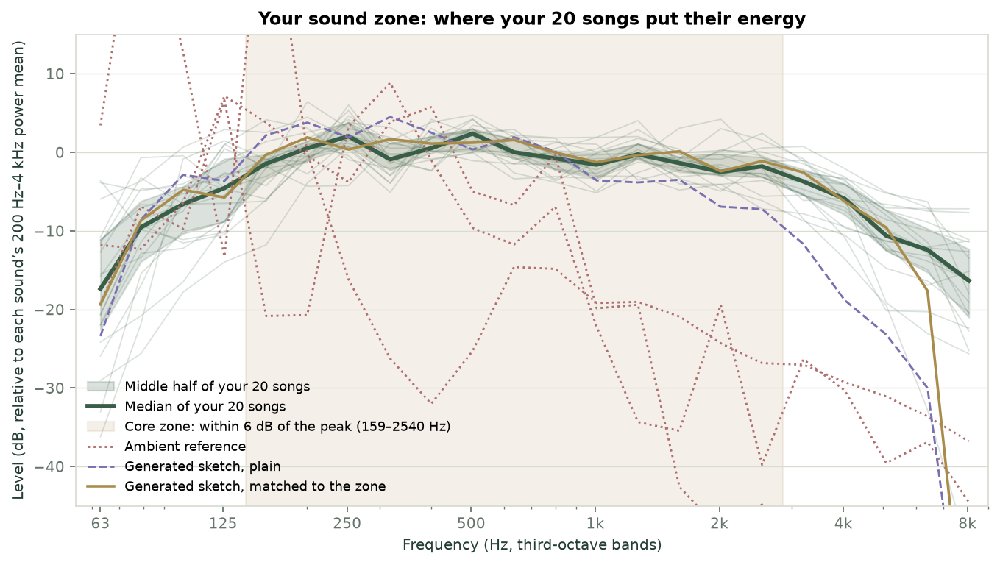
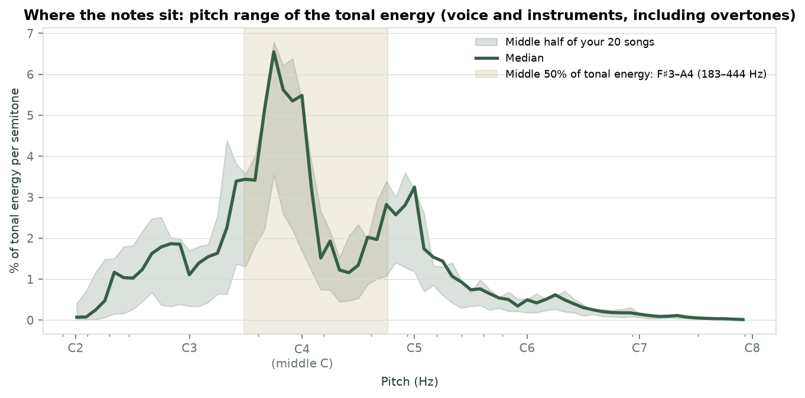
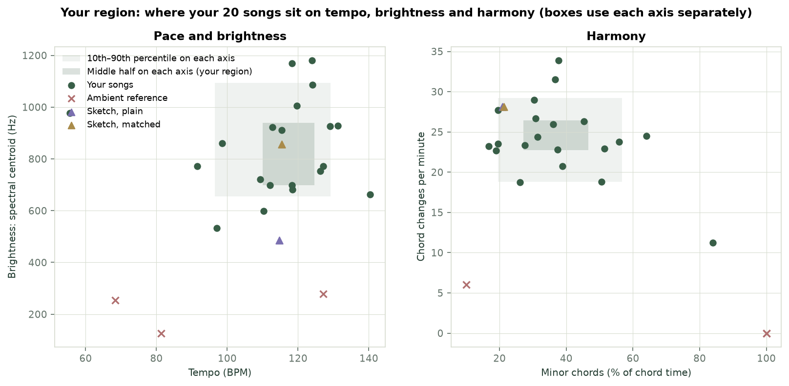

# Song DNA: 20 Kishore Kumar songs, measured end to end

This report covers 20 full-length Kishore Kumar recordings, taken from official label uploads. Each was checked against a second, independently obtained copy where one exists: 18 are the same recording in both sets, and two second copies are a DJ remix and a short sad-version excerpt. It sets out what they share, what they don't, and what we can and can't conclude. The evidence behind every interpretation is in [song-dna-research.md](song-dna-research.md): a fact-checked brief built from peer-reviewed and primary sources.

## Short answer

**It is not a frequency.**
- The songs' home notes fall on 9 of the 12 notes of the octave.
- Tuning spreads from −41 to +44 cents. Four songs sit within 10 cents of "432 Hz" tuning, exactly what chance would give.
- **The same recording's tuning differs between copies.** In the test–retest comparison below, only 9 of the 18 songs available as the same recording from two sources kept their tuning within 5 cents. "Mera Jeevan Kora Kagaz" runs about 52 cents higher and about 4% faster in one copy than the other. That is consistent with a playback or transfer-speed difference: a 3% speed change would give about 52 cents and 3% in tempo, and the tempo reading is rough.

So tuning describes the copy, not the song. Many people do remember the exact pitch of recordings they know well (Levitin 1994; Frieler et al. 2013), so a familiar version may feel "right" because of memory, not because the brain prefers one frequency.

**What they share is a harmonic vocabulary and an era's sound:**
- **Moderate, steady tempos.** Median 118 BPM; the middle half run 110–125 BPM. These are not slow songs.
- **An even split of major and minor keys.** 10 and 10, across 15 keys. 19 have a clear mode; Pyar Diwana Hota Hai sits between D minor and F major, which share the same notes. Major-key songs lean on the major third (♭3:3 ratio 0.39–0.63), and minor-key songs on the minor third (1.06–2.09). That is in line with the about-half Bilawal (major) and Asavari (natural minor) split reported for Hindi film hits (Choudhury et al., ISMIR 2013).
- **Your G chord travels furthest.** Of your four triads (Am, G, F, E), the ♭VII chord (G when A is home) is the most shared. It appears in 16 of 20 songs and fills more than 3% of chord time in 13, and it swings with the home chord in both minor songs (i ↔ ♭VII) and major songs (I ↔ ♭VII), 4 songs each. The home chord ↔ V swing is the most common move overall (I → V → I in 8 songs).
- **The Andalusian walk is a rare colour, not a formula.** Starting on the song's own home chord, it appears in 1 song: Dilbar Mere Kab Tak, twice, going all the way to V (Am → G → F → E with A as home). The same shape appears only on other degrees in 7 more songs, such as vi → V → IV in a major key.
- **Busy but simple harmony.** About 24 chord changes per minute, 8–9 main chords per song, and about half of ~4-second passages recur later.
- **A mono-like sound.** Median stereo correlation is 1.00; most of these transfers are effectively mono.

No dataset here can explain why these songs became hits. All of these songs are famous and there is no comparison set of non-hits. Large studies find that audio features predict popularity poorly (Pachet & Roy 2008; Interiano et al. 2018).

## The songs

| Group | Songs |
| --- | --- |
| Profile (20) | Hamen Tumse Pyar Kitna, Aa Chal Ke Tujhe, Chalte Chalte Mere Yeh Geet, Chehra Hai Ya Chand Khila Hai, Choo Kar Mere Man Ko, Dil Kya Kare Jab Kisi Ko, Dilbar Mere Kab Tak Mujhe, Dream Girl, Ek Ajnabee Haseena Se, Ek Ladki Bheegi Bhagi Si, Kitne Bhi Tu Karle Sitam, Mera Jeevan Kora Kagaz, Mere Sapnon Ki Rani, O Mere Dil Ke Chain, Saagar Kinare, Yeh Dosti Hum Nahin Todenge, Yeh Shaam Mastani, Roop Tera Mastana, Bachna Ae Haseeno, Pyar Diwana Hota Hai |

**Sources.**
- **The profile set.** The listed songs come from official uploads by Saregama Music, Universal Music India and the "Kishore Kumar – Topic" channel ([sources manifest](../data/song-dna/kishore-kumar-sources.json)). Each was downloaded as YouTube's best audio stream (Opus, 112–149 kb/s, 48 kHz) with no re-encoding, using [analysis/fetch_song_set.py](../analysis/fetch_song_set.py).
- **What higher quality changes.** The analysis runs at 22.05 kHz, so codec differences above about 11 kHz don't affect it. The real gain from this set is official versions of every song, including full originals in place of the remix and the excerpt. Two official uploads (Chalte Chalte, Ek Ladki Bheegi Bhagi Si) are about 35 s shorter than the first-set files.
- **The first set.** The owner's earlier set of MP3s (mostly 128 kb/s; two at 320 kb/s, the DJ remix at 192 kb/s and a 1:53 sad-version excerpt at 40 kb/s), serves as the independent copy for the test–retest and same-recording checks.

**Each download was checked against the first-set copy.** [analysis/same_recording_check.py](../analysis/same_recording_check.py) aligns chroma with DTW and compares each pair with mismatched songs as a baseline. Two "Topic" uploads (Aa Chal Ke Tujhe and Ek Ajnabee Haseena Se) scored no higher than unrelated songs, so they are different recordings or arrangements. They were replaced with Saregama uploads that match (0.93 and 0.95).

Audio stays on the owner's machine. The repository holds only derived summary numbers in [dist/data/song-dna/kishore-kumar.json](../dist/data/song-dna/kishore-kumar.json): no audio, lyrics, melodies, chord timelines or section order. Source files are identified by a hash of their file name, and the manifest lists public video IDs.

## Method

One analyser, [dist/song-dna.js](../dist/song-dna.js), runs both in Node (to build the profile) and in the browser (to compare a song), so the numbers are directly comparable.

- **Input.** Full song, stereo, 22.05 kHz; 4096-point STFT with a 1024-sample hop.
- **Tuning.** Magnitude-weighted circular mean of interpolated spectral peaks (80–2000 Hz), in cents from A440.
- **Chroma.** 98–2100 Hz, tuned. Each frame's median noise floor is subtracted, and every pitch class is normalised by the bin weight that feeds it.
- **Key.** Krumhansl–Kessler profile correlation, plus chord-function evidence: tonic, a major V and subdominant roles. The second step separates relative keys that pitch profiles confuse.
- **Chords.** 24 major and minor triads plus no-chord, on ~0.37 s windows, smoothed with an HMM (Viterbi). Labels are triads only.
- **Progressions.** Roman numerals relative to the key; 2-, 3- and 4-chord n-grams. The Andalusian cadence is detected without relying on the key (minor X → major X−2 → major X−4 → major X−5).
- **Tempo.** Autocorrelation of onset flux with a 110 BPM prior.
- **Loudness.** ITU-R BS.1770 K-weighting with gating; loudness range per EBU Tech 3342; crest factor.
- **Spectrum.** Third-octave long-term average, tilt from 100 Hz to 5 kHz, centroid, and share of energy in the 1–4 kHz presence band.
- **Stereo and repetition.** L/R correlation and side/mid ratio; repetition is the share of ~4.5 s chroma passages that recur at least 10 s away.

Rebuild:

```sh
.venv/bin/python -I analysis/fetch_song_set.py --manifest data/song-dna/kishore-kumar-sources.json \
  --output-dir ~/Desktop/songs/Kishore_Kumar_youtube
node analysis/build_song_dna.mjs --dir ~/Desktop/songs/Kishore_Kumar_youtube --artist "Kishore Kumar" \
  --out dist/data/song-dna/kishore-kumar.json
.venv/bin/python -I analysis/song_dna_crosscheck.py --dir ~/Desktop/songs/Kishore_Kumar_youtube \
  --dna dist/data/song-dna/kishore-kumar.json --out data/song-dna/kishore-kumar-crosscheck.json
node analysis/compare_songs.mjs dist/data/song-dna/kishore-kumar.json path/to/other/songs/*.mp3
# Test–retest against a second copy of the same songs, and a same-song check:
node analysis/build_song_dna.mjs --dir ~/Desktop/songs/Kishore_Kumar --artist "Kishore Kumar (first set, MP3)" \
  --out data/song-dna/kishore-kumar-first-set.json --exclude "DJ_"
node analysis/compare_sets.mjs data/song-dna/kishore-kumar-first-set.json dist/data/song-dna/kishore-kumar.json \
  --out data/song-dna/kishore-kumar-test-retest.json
.venv/bin/python -I analysis/same_recording_check.py --a ~/Desktop/songs/Kishore_Kumar --b ~/Desktop/songs/Kishore_Kumar_youtube \
  --out data/song-dna/kishore-kumar-same-recording.json
```

Adding an artist means running the same build with another folder. The page currently loads Kishore Kumar only; the data format already supports more artists.

## Validation

1. **Synthetic songs with known answers** ([tests/song-dna.test.mjs](../tests/song-dna.test.mjs)). These cover an Andalusian song in A minor tuned +18 cents, a I–V–vi–IV song in D, a −35-cent detuned song, and two songs with a broadband noise floor.
   - Keys correct.
   - Tuning within 1–3 cents.
   - Tempo within 1 BPM.
   - Chord accuracy 100%.
   - Sketches from the style-sketch generator are analysed back into 83–94% of their chords, and their melodies stay in key in every tested key.
2. **A bug found by real recordings.** The first version read 9 of 18 songs as A minor. Noise floors had pushed extra energy into pitch classes covered by one more octave at the edges of the range. The fix subtracts each frame's noise floor and normalises bin weights per pitch class. A regression test now fails on the old code: a noisy F# minor song was read as E, with the raw key profile saying A minor.
3. **Independent cross-check with librosa** (different algorithms; [data/song-dna/kishore-kumar-crosscheck.json](../data/song-dna/kishore-kumar-crosscheck.json)).
   - **Tuning:** mean absolute difference 3.4 cents.
   - **Tempo:** agrees on 17 of 20 songs; 2 are half/double-time readings and 1 differs.
   - **Key:** agrees on 15 of 20. Of the 5 disagreements, 2 are a fifth apart and 2 are relative major/minor; only 1 is unrelated. Agreement between two estimators is not accuracy: neither is ground truth. State-of-the-art trained models reach about 68–80% exact accuracy on pop, with errors clustering on fifths and relative keys (Korzeniowski & Widmer 2018). Template methods on old film recordings are expected to do worse, so read key letters loosely until a musician checks a sample.
4. **Test–retest: the same songs from two independent sources** ([data/song-dna/kishore-kumar-test-retest.json](../data/song-dna/kishore-kumar-test-retest.json), `sameRecording` summary). This compares the official uploads with the owner's first-set MP3s, for the 18 songs that are the same recording in both.
   - **Key:** identical for 16 of 18. One flips between A major and A minor, and one other changes.
   - **Tempo:** identical for 16 of 18 (one half-time reading, and Mera Jeevan Kora Kagaz runs about 4% faster in one copy).
   - **Tuning:** within 5 cents for only 9 of 18, with differences up to about 50 cents.
   - **Loudness:** differs by up to about 10 LU.

   So key, chords and tempo describe the music. Tuning and loudness describe the particular transfer and master.
5. **Same song, checked by chroma alignment** ([data/song-dna/kishore-kumar-same-recording.json](../data/song-dna/kishore-kumar-same-recording.json)).
   - **Method:** DTW-aligned chroma similarity for each pair, against all 19 mismatched songs.
   - **Same recordings:** all 18 same-recording pairs score 0.93–0.97, each 0.02–0.07 above its best mismatched pair (mismatched pairs score up to 0.94, so the margin is real but modest). The DJ remix of Hamen Tumse Pyar Kitna also scores 0.96, because it reuses the original's vocal and harmony. So this check confirms the same song and arrangement, not the same master.
   - **The exception:** Yeh Dosti scores 0.83, below its mismatched pairs, as expected: the first-set file was the sad version.
   - **Rejected uploads:** this check is how the two different-recording "Topic" uploads were found and replaced.
6. **Comparisons with other audio** ([data/song-dna/kishore-kumar-comparisons.json](../data/song-dna/kishore-kumar-comparisons.json)):

| Audio | Closeness to the profile |
| --- | --- |
| Each profile song against the other 19 | median 72% (47–84%) |
| The DJ remix of Hamen Tumse Pyar Kitna | 76%, and its nearest profile song is the original |
| The 1:53 sad-version excerpt of Yeh Dosti | 58% |
| Three ambient/binaural reference excerpts | 21–39% |
| Two generated sketches (Am–G–F–E and I–V–vi–IV) | 40–49% |

Closeness is half 13 measured features (tempo, loudness, brightness, chord density, repetition and more; tuning is shown but not scored, because it reflects the copy) and half harmony (scale-note use compared with same-mode songs, and chord roles). So a song with the same chords but modern production can score lowish. A real contrast set, such as modern Hindi film songs, Western pop and other singers of the era, is the next test.

## Your sound zone

Taken one at a time, the songs differ in key, tempo and tuning. Taken together, they share a clear *region*: not a single frequency, but a consistent way of spreading sound.



- **Where the energy sits.** Relative to each song's own 200 Hz–4 kHz power average, the median spectrum stays within 6 dB of its peak from **159 Hz to 2.5 kHz** (the core zone). It then falls about 15 dB by 8 kHz, and the deepest bass below about 125 Hz is rolled off. The 20 songs hug this shape tightly; the ambient references don't.
- **Where the notes sit.** Half of the tonal energy lies between **F♯3 and A4 (183–444 Hz)**, and 80% between A♯2 and E5. That's voice and instruments with percussion removed, and it includes overtones, so it's broader than the sung notes alone. That is the range of the singing voice and the instruments around it.
- **Pace, brightness and harmony.** Taking each measure on its own, the middle half of the songs run 110–125 BPM, with a spectral centroid of 700–940 Hz, 27–47% minor chords and 23–26 chord changes a minute. Fewer songs fall inside all of these ranges at once.




**What this does and doesn't mean.** The zone describes your 20 songs. It is not a measurement of your brain, and it isn't a frequency to listen to. Whether it is what calms *you* is a hypothesis, and the page lets you check it. Play a sketch, then hear the same sketch again matched to the zone or plain, at equal loudness, and rate both. Still keeps score of these pairs. You know which version is playing, so it is a personal check, not a blinded test.

**Per-song plots.** Each song has a full-length spectrogram, a chromagram, its spectrum against the set, and its pitch range. These are drawn by [analysis/plot_song_dna.py](../analysis/plot_song_dna.py) into the owner's song folder (`plots/`), never into the repository. Detailed time–frequency pictures of whole songs come close to a transcription, so only the aggregate charts above are shared.

```sh
.venv/bin/python -I analysis/plot_song_dna.py --dir ~/Desktop/songs/Kishore_Kumar_youtube \
  --dna dist/data/song-dna/kishore-kumar.json --contrast data/song-dna/kishore-kumar-comparisons.json \
  --private-out ~/Desktop/songs/Kishore_Kumar_youtube/plots --figures figures/song-dna \
  --zone-out dist/data/song-dna/kishore-kumar-zone.json   # add --skip-private to redraw only the shared charts
```

## Song vector index

Every analysed song becomes a 78-dimensional vector ([dist/song-index.js](../dist/song-index.js)), built from measurements Song DNA already validates. The vector has seven blocks, each scaled to unit length and then weighted:

| Block | What it holds | Weight |
| --- | --- | --- |
| Musical | Tempo, minor-chord share, chord changes per minute, distinct chords, note events, repetition (robust z-scores) | 1 |
| Scale | Key-relative 12-note profile | 1 |
| Scale shape | Fourier magnitudes of the 12-note profile, unchanged by key errors | 1 |
| Chords | Share of time in each of 24 chord roles (I, i, ♭VII, …) | 1 |
| Spectrum | Third-octave shape of the zone chart | 0.7 |
| Production | Tilt, brightness, presence, loudness, loudness range, crest, stereo | 0.5 |
| Mode | Major or minor | 0.4 |

Profile-like blocks (spectrum, scale, scale shape, chords) are centred on the indexed set before scaling, so each block measures differences between songs. Search is cosine similarity. The page shows a 2-D map (PCA), each song's nearest neighbours, and where an uploaded song lands.

**Does it work? An identification test** ([data/song-dna/kishore-kumar-index-eval.json](../data/song-dna/kishore-kumar-index-eval.json), [analysis/eval_song_index.mjs](../analysis/eval_song_index.mjs))

The index is built from the official recordings and queried with the 18 songs we also had as independently obtained MP3 copies. Ties are ranked fairly, so a tie never counts in a method's favour.

| Method | Same song first (recall@1) | In top 3 | MRR |
| --- | --- | --- | --- |
| Random guessing | 5% | 15% | 0.18 |
| Tempo only | 56% | 89% | 0.73 |
| Key name only | 56% | 89% | 0.79 |
| Key name, then nearest tempo | 83% | **100%** | 0.90 |
| **Vector index, default weights** | **94%** | 94% | **0.95** |
| Musical block only | 83% | 94% | 0.89 |
| Scale block only | 94% | 94% | 0.95 |
| Chords block only | 89% | 94% | 0.91 |
| Spectrum block only | 61% | 83% | 0.73 |
| Production block only | 11% | 28% | 0.27 |
| All blocks weighted equally | 83% | 94% | 0.90 |

What we learn:
- **On this test the index beats a simple key-and-tempo lookup by one song.** It ranks 17 of 18 first, against 15 for the lookup, though the lookup has every song in its top 3. The richer vector earns its keep only when key labels fail or many songs share a key and tempo, which a bigger catalogue will test.
- **Production features describe the copy, not the song.** On their own they find almost nothing, matching the test–retest result.
- **Key errors are the main failure.** The one miss, Saagar Kinare at rank 7, had its key read as A minor in one copy and F major in the other, which shifts the key-relative blocks. The remix (rank 3) and the sad-version excerpt (rank 6) are also different recordings, and their keys were read differently from the originals'.

**Limits, stated plainly.**
- **This is an identification test.** Every query is the same recording from another source. It does not show that the index's neighbours for *different* songs sound alike to listeners; that needs listener judgements, which haven't been collected.
- **The figures are in-sample.** The musical-versus-production split and the production down-weight came from the test–retest comparison of these same 18 pairs, and the key-free block was added after the first results. Treat the numbers as optimistic. The ablations also show the index would score higher without the scale block, but the weights are frozen rather than tuned on the very pairs reported here.
- **Twenty songs from one artist is an easy setting.** The real test adds other artists as distractors, with the weights already fixed.

**What it is for.** Finding songs that sound like the ones a listener finds calming (once listener tests confirm the neighbourhoods), placing new songs or sketches in that space, and later a taste centre weighted by ratings. The map's ring is currently the plain average of the set. It does **not** make a hit deterministic: popularity depends on things outside the audio, such as the film, the star, lyrics, radio play, timing and social contagion (Salganik et al. 2006; Pachet & Roy 2008; Interiano et al. 2018).

## Product: Song DNA page

[dist/songs.html](../dist/songs.html) does five things:
1. Shows the profile: home notes and tuning, key and mode, chord roles, scale-note use, your Andalusian triads and typical ranges.
2. Shows **your sound zone** (the spectral and pitch-range charts above) and the five songs with the highest leave-one-out closeness to the rest, the most typical of the set. Currently these are Mere Sapnon Ki Rani, Dream Girl, Yeh Shaam Mastani, Dilbar Mere Kab Tak and Mera Jeevan Kora Kagaz; the last two are tied.
3. Compares any song you own, in the browser and without uploading it, and shows its chord timeline (never stored).
4. Makes **style sketches**. These are original instrumentals in Keherwa or Dadra feel, with pad or harmonium-like textures and a sung-vowel-like melody, or a santoor-like texture with a flute-like melody. They use only common building blocks (key, tempo, generic chord progressions); the melody is a seeded random walk over chord tones, and no song's melody, lyrics or recording is used.
   - **Match your songs' sound** EQs the finished sketch toward the zone's median spectrum. The two passes together stay within ±12 dB per band, quiet bands are lifted by at most 6 dB, empty bands are only ever cut, and nothing above 8 kHz or below 63 Hz is boosted. Filtering is zero-phase. Afterwards plain and matched versions are set to the same loudness-weighted level, so matching never makes a sketch louder.
   - **How close matching gets** (averaged over the bands each texture actually fills): pad and harmonium go from about 4 dB to about 1 dB from the zone; santoor/flute from about 8 dB to 4 dB; a pad with the melody off from 8 dB to 3 dB, across 75% of the bands. Matching raised a harmonium sketch's closeness to the profile from 42% to 48%. The rest of the gap is real production (vocals, orchestra, density) that a procedural sketch doesn't have.
   - **Make one for me** picks a progression, texture, feel and matched-or-plain setting by Thompson sampling over your ratings. Each option keeps a Beta score from "Calming / Neutral / Not for me", so it favours what has worked and still tries other options now and then. Key comes from your songs' most common home notes, and tempo from inside their middle-half range. Your own Am–G–F–E triads get a small head start.
5. Learns taste from your ratings, stored on this device, and keeps score of paired matched-versus-plain comparisons ("Hear the other version").

All playback goes through Still's safety chain and follows the comfort profile's current state (quieter when you feel very sensitive).

## Next steps

- Add other artists (Rafi, R.D. Burman, Asha Bhosle, Lata Mangeshkar) with the same build script, plus a contrast set.
- Feed sketch ratings into the comfort profile's preference learner (progression × tempo × texture × feel).
- Add a roughness measure. Roughness is the cue most consistently linked to unpleasantness across cultures (Athanasopoulos 2021; Milne et al. 2023).
- Have a musician check the keys and chords of a few songs to measure real accuracy on this repertoire.
- Get legal review covering India and the US before any public or commercial launch. The recordings' rights mostly belong to labels such as Saregama.
